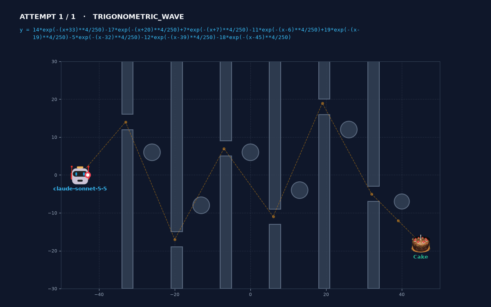

# GraphWars-LLM

**Exploring LLMs for Symbolic Trajectory Generation in Graphwar**



*Needle gauntlet: six walls with 4-unit windows, a mine on every swing, and a 180-character formula limit. Solved on the first attempt with a 179-character formula.*

> "I build a sum of flat-topped bumps, A\*exp(-(x-xc)^4/250), each centered on a gap. Between bumps the curve stays close to y=0, which clears the mines. Each bump has width about 4, so the curve stays near the gap center across the whole 3-unit wall thickness."
>
> — Claude Sonnet 5.5

---

## What is Graphwar?

**Graphwar** is an artillery game on a 2D Cartesian plane where projectiles are driven by mathematical functions ($y = f(x)$ or differential equations) rather than standard angle and power. Players must formulate equations that navigate around terrain and obstacles to hit opponent targets.

---

## The Challenge

1. **Continuous 2D Spatial Geometry:** Navigating complex obstacles and terrain without clipping.
2. **Formula Constraints:** Mathematical functions must satisfy strict game constraints such as character length limits and valid mathematical operators.
3. **Pure Math Limitations:** Traditional numerical interpolation and curve-fitting methods (like Fourier series or DCT) lack spatial reasoning, often resulting in severe oscillations (Runge's phenomenon) or obstacle collisions without human guidance.

---

## Project Goal

This project explores how Large Language Models (LLMs) can be leveraged for spatial search, reasoning, and generating symbolic mathematical trajectories in constrained 2D environments.

---

## Repository Structure

```
graphwars_LLM/
├── README.md               # Project overview
├── plan.md                 # Implementation steps & roadmap
├── src/
│   ├── engine/             # 2D simulation environment
│   │   ├── backend/        # Coordinate space, obstacles, trajectory physics & collision
│   │   └── ui/             # Real-time visual interface & rendering
│   ├── llm_agent/          # LLM reasoning & agent components
│   └── experiments/        # Scenarios, benchmarks & tests
├── experiments/scenarios/  # Scenario JSON files
├── tools/                  # Video generator for run playback
├── assets/, docs/media/    # Icons and README media
└── tests/                  # Unit and integration tests
```

## Try It

```bash
python -m src.llm_agent.run_single_test_agent -s scenario_6_needle_gauntlet -p anthropic -a 5
python tools/video_generator.py outputs/<run_folder>
python main.py
```

Each run writes `outputs/<scenario>_<timestamp>/` with the scenario, attempt history, raw API traffic and the model's thinking summary.
